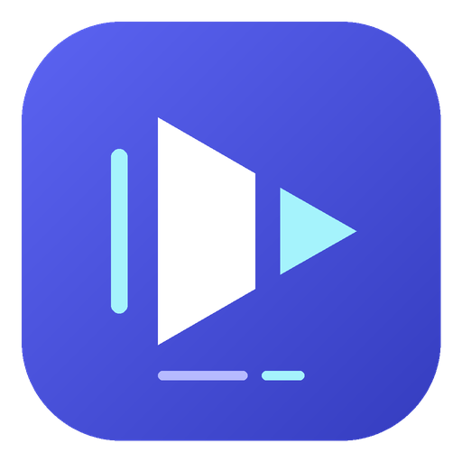
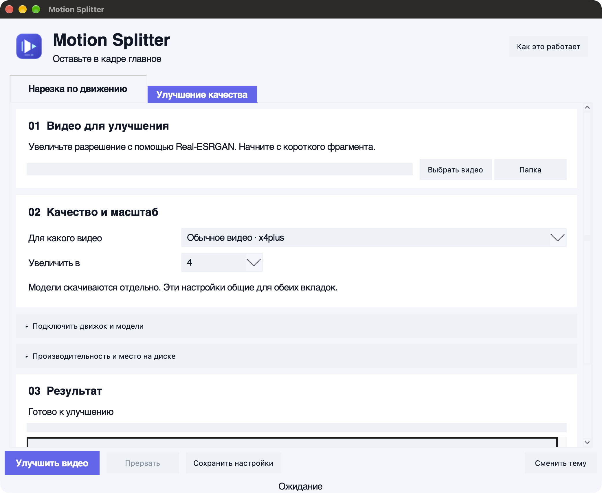

# Motion Splitter

**Keep the moments that move.** A local desktop application that detects visual
motion in videos, exports separate clips, and optionally increases their resolution
with Real-ESRGAN.

[Русская документация](README.ru.md) · [User guide (Russian)](docs/USER_GUIDE.md) · [Development](docs/DEVELOPMENT.md)

## What can you use it for?

- **Surveillance footage:** extract periods of visual activity from a stationary
  camera recording instead of reviewing long inactive stretches.
- **Video podcasts and interviews:** prepare motion-based selects where visible
  activity is useful. This is not a speech detector, silence remover, speaker
  tracker, or automatic podcast editor: a still person speaking may be missed.
- **Workshop, garage and process recordings:** keep intervals with activity and
  add a little context before and after each event.
- **Batch preparation:** process a folder of recordings and review per-file results.

The detector measures image changes. Camera movement, lighting changes and noise
can also trigger it. It does not recognize people or objects and is not a security
alarm system. Review results before relying on them.

## Features

- Single-file and folder processing, automatic or manual motion sensitivity.
- Fast stream-copy export or frame-accurate H.264/AAC MP4 export.
- Minimum event duration, smoothing, padding and merging of nearby events.
- Optional Real-ESRGAN enhancement of clips or separate videos.
- Presets, preview, progress, cancellation and JSON reports.
- Light/dark themes, dropdowns and numeric controls. The current app UI is Russian.

Original videos are not overwritten. Each run creates a separate results folder
beside the source. Video processing is local; videos and logs are not automatically
uploaded. The model download button opens the upstream website.

## Getting started

Run from source using the [development instructions](docs/DEVELOPMENT.md).
Choose a video, select automatic motion detection, pick an export mode, and start.
Fast mode follows keyframe boundaries; accurate mode re-encodes the selected clips.
Only the first ordinary video stream and first audio track are retained.

Models are unnecessary for splitting. To enhance videos, install the external
Real-ESRGAN engine and compatible models using the [model guide](docs/MODELS.md).
Model weights are downloaded separately and are not included in installers.

## Downloads and platform status

**Pre-release project: three-platform release packages are not yet available.**
The intended release contains these three native installers, with FFmpeg and
FFprobe bundled:

| Platform | Installer | Current verification |
|---|---|---|
| Windows x64 | `.exe` via Inno Setup | Build scripts prepared; native build and installation testing pending |
| macOS Apple Silicon | `.pkg` containing `.app` | Local development package tested; distribution dependencies, clean installation and notarization pending |
| Linux amd64 | `.deb` | Build scripts target Ubuntu 24.04; native acceptance pending; Debian requires separate testing |

Local development packages are not distribution-ready and are not uploaded as
release downloads. See [installer requirements](docs/INSTALLERS.md) and the
[release roadmap](docs/ROADMAP.md). Source availability does not imply that all
three platforms have passed testing.

## Limitations

- Output publication currently requires hard-link support. APFS was tested;
  FAT/exFAT are not supported.
- Accurate export and enhancement produce H.264/AAC MP4; HDR/10-bit preservation,
  additional audio tracks, subtitles and chapters are not supported guarantees.
- Folders are scanned without recursion.
- Enhancement requires a compatible GPU and substantial temporary disk space.
  Small real tests passed on Apple M5; long high-resolution runs remain unverified.

## Contributing and support

Use this repository's Issues forms for bugs and feature requests. Include the app
version, OS, reproduction steps and a sanitized log. Remove personal file paths
and do not upload private recordings.

[Contributing](CONTRIBUTING.md) · [Troubleshooting](docs/TROUBLESHOOTING.md) ·
[Changelog](CHANGELOG.md) · [Real-video acceptance](docs/ACCEPTANCE_2026-11-19.md)

## License

Original project code, documentation and icon are licensed under [MIT](LICENSE).
Third-party libraries, FFmpeg, engines and models retain their own licenses.
See [third-party notices](THIRD_PARTY_NOTICES.md).
