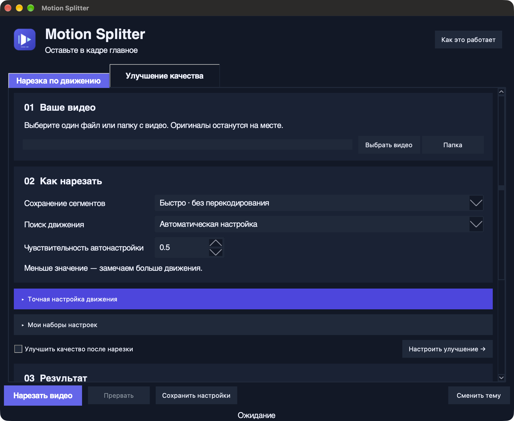

  

# Motion Splitter

**Оставьте в кадре главное.** Настольное приложение, которое находит движение
в видео, сохраняет отдельные фрагменты и при желании увеличивает их разрешение
через Real-ESRGAN. Обработка видео выполняется локально.

**Статус: подготовка первого релиза.** Проверена development-сборка 0.18.0
на macOS arm64. Публичный v1.0 ещё не выпущен; Windows/Linux и установка
на чистых системах ожидают проверки. [План релиза](docs/ROADMAP.md).

## Возможности

- Один файл или папка с видео, автоматическая и ручная настройка детектора.
- Быстрая нарезка без перекодирования или точный экспорт MP4.
- Запас до/после движения, объединение близких событий и свои наборы настроек.
- Необязательное улучшение готовых сегментов или отдельного видео.
- Предпросмотр, прогресс, отмена и отчёт по каждому файлу.
- Светлая/тёмная темы, раскрывающиеся настройки, списки и числовые переключатели.

Результаты каждого запуска сохраняются в отдельной папке рядом с исходником.
Оригиналы и ранее созданные результаты не перезаписываются.

## Как начать

Готовых публичных загрузок пока нет. Для запуска из исходников см.
[установку для разработчика](docs/DEVELOPMENT.md).

1. На вкладке **«Нарезка по движению»** нажмите **«Выбрать видео»** или **«Папка»**.
2. В списке **«Поиск движения»** выберите **«Автоматическая настройка»**.
3. Выберите **«Точно · MP4, до кадра»** для точных границ или быстрый режим
   для копирования потоков с границами, зависящими от ключевых кадров.
4. Нажмите **«Нарезать видео»**. Путь результатов появится в журнале.

Для обычной нарезки модели не нужны. Для улучшения отдельно скачиваются движок
и совместимые модели; приложение содержит ссылку на официальный источник.
[Установка моделей](docs/MODELS.md).

## Платформы и установщики

| Платформа | Формат первого релиза | Фактический статус |
|---|---|---|
| macOS arm64 | `.pkg` с приложением `.app` | Development-пакет проверен на доступном Mac; чистая установка, минимальная ОС и публичная подпись ещё не подтверждены |
| Windows x64 | `.exe`, Inno Setup | Сценарий подготовлен; нативная сборка и приёмка не выполнены |
| Linux amd64 | `.deb`, Debian/Ubuntu | Сценарий подготовлен для базы Ubuntu 24.04; нативная приёмка не выполнена, Debian проверяется отдельно |

FFmpeg и FFprobe предусмотрены внутри установщиков. Движок улучшения и модели
устанавливаются отдельно. Текущий development-комплект не готов к публичному
распространению: остаются работы по составу зависимостей и их уведомлениям.
[Подробности упаковки](docs/INSTALLERS.md).

## Что важно знать

- Детектор видит изменение изображения, включая свет и движение камеры;
  распознавания людей и объектов нет. Папки обрабатываются без подпапок.
- Сохранение требует файловой системы с жёсткими ссылками. APFS проверена;
  FAT/exFAT сейчас не подходят.
- Точный экспорт и апскейл создают H.264/AAC MP4. Сохранение HDR/10-bit,
  нескольких аудиодорожек, субтитров и глав не обещается.
- Улучшение требует совместимого GPU и свободного диска. На Apple M5 проверены
  пробные запуски и короткий фрагмент; длительный Full HD/8K апскейл не проверен.

## Документация и участие

- [Руководство пользователя](docs/USER_GUIDE.md) · [Справочник алгоритма](docs/REFERENCE.md)
- [Решение проблем](docs/TROUBLESHOOTING.md) · [Модели улучшения](docs/MODELS.md)
- [Разработка и проверки](docs/DEVELOPMENT.md) · [Как внести вклад](CONTRIBUTING.md)
- [Изменения](CHANGELOG.md) · [План](docs/ROADMAP.md) · [Приёмка на реальном видео](docs/ACCEPTANCE_2026-11-19.md)

После публикации репозитория сообщить об ошибке или предложить функцию можно
через **Issues → New issue**. В репозитории подготовлены формы для обоих случаев.
Перед отправкой журналов уберите личные пути и имена файлов.

## Лицензия

Собственный код, документация и иконка проекта — [MIT](LICENSE).
Сторонние компоненты сохраняют свои лицензии; MIT проекта не заменяет условия
FFmpeg, Python, библиотек, движка или моделей. [Сведения о зависимостях](THIRD_PARTY_NOTICES.md).
